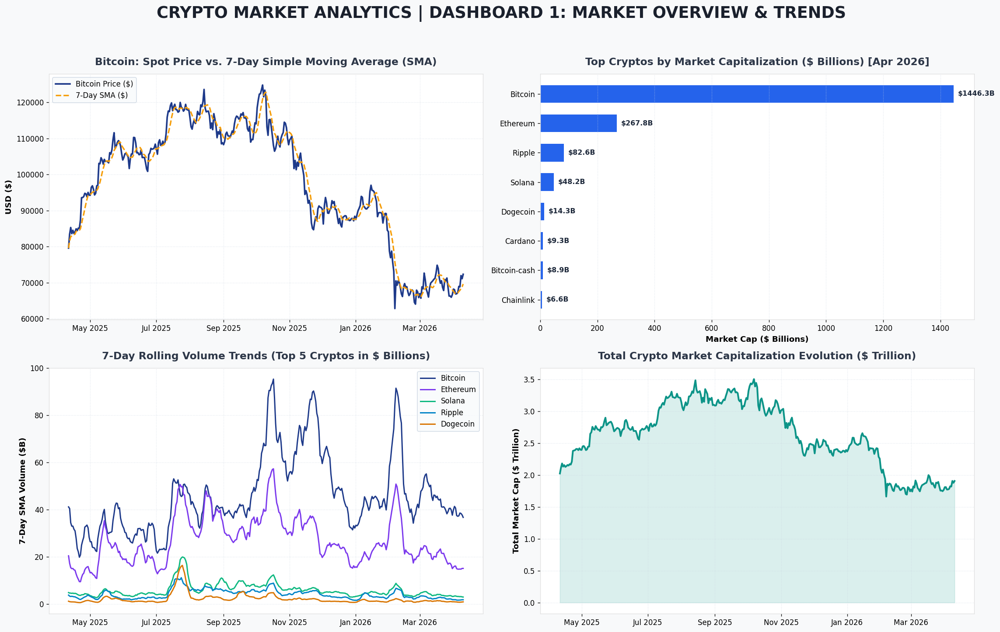
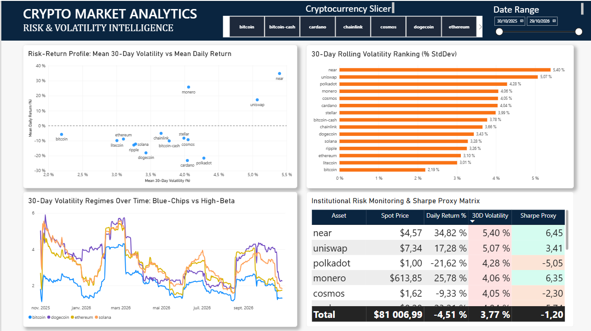

# Azure Databricks Crypto Market Analytics & Medallion Pipeline

[](https://databricks.com/)
[](https://spark.apache.org/)
[](https://delta.io/)
[](https://powerbi.microsoft.com/)
[](https://www.python.org/)

An enterprise-grade Big Data & Analytics Engineering project implementing a **Medallion Lakehouse Architecture (Bronze → Silver → Gold)** on **Azure Databricks** with **PySpark** and **Delta Lake**, delivering dimensional star-schema modeling and executive risk intelligence dashboards in **Power BI**.

---

## 📌 Executive Summary & Key Highlights

- **Scale & Scope:** 365 days of continuous market observations across 15 leading cryptocurrency assets (5,475 time-series records) covering spot price, volume, and market capitalization.
- **Architecture:** Robust Medallion Architecture decoupling raw multi-source ingestion (Bronze) from cleansed data lakes (Silver) and dimensional analytical marts (Gold).
- **Advanced PySpark Engineering:** Leveraging native PySpark `Window` specifications (`partitionBy`, `orderBy`, `rowsBetween`) for rolling 7-day Simple Moving Averages (SMA), 30-day volatility standard deviations, and 1-day lag price changes.
- **Dimensional Modeling:** Decoupled **Kimball Star Schema** featuring surrogate-keyed dimensions (`dim_coin`, `dim_date`) and a normalized fact table (`fact_marketdata`) optimized for sub-second analytical querying in Power BI VertiPaq.
- **Dual Dashboards:** 2 interactive executive dashboards providing macroeconomic market trends and institutional risk/volatility intelligence.

---

## 🏗️ End-to-End System Architecture

```text
+---------------------------------------------------------------------------------------+
|                        MEDALLION LAKEHOUSE PIPELINE                                   |
+---------------------------------------------------------------------------------------+
|                                                                                       |
|   +-------------------+      +---------------------+      +-----------------------+   |
|   |   BRONZE LAYER    | ---> |    SILVER LAYER     | ---> |      GOLD LAYER       |   |
|   |  (Raw Ingestion)  |      | (Cleansed & Enriched)|     | (Dimensional Modeling)|   |
|   +-------------------+      +---------------------+      +-----------------------+   |
|   | • 15 CoinGecko    |      | • Schema parsing &  |      | • dim_coin (Surrogate)|   |
|   |   JSON Payloads   |      |   array exploding   |      | • dim_date (Calendar) |   |
|   | • Multi-level     |      | • Deduplication     |      | • fact_marketdata:    |   |
|   |   nested arrays   |      | • ISO date parsing  |      |   - 7D SMA Price      |   |
|   | • Audit metadata  |      | • Parquet/Delta lake|      |   - 30D Volatility    |   |
|   +-------------------+      +---------------------+      |   - 7D SMA Volume     |   |
|                                                           |   - Daily Return %    |   |
|                                                           +-----------------------+   |
|                                                                       |               |
+-----------------------------------------------------------------------|---------------+
                                                                        v
                                                        +-------------------------+
                                                        |   POWER BI SEMANTIC     |
                                                        +-------------------------+
                                                        | • VertiPaq Star Schema  |
                                                        | • 12+ DAX Measures      |
                                                        | • 2 Executive Views     |
                                                        +-------------------------+
```

---

## 📊 Executive Dashboards Preview

### Dashboard 1: Market Overview & Trends

Comprehensive macroeconomic tracking of spot valuations, 7-day moving averages, market dominance, and aggregate capitalization trends.



- **Spot vs. 7-Day SMA:** Visualizes moving average smoothing over 365 trading sessions, identifying momentum crossovers.
- **Market Capitalization Dominance:** Real-time breakdown of asset valuations across the crypto ecosystem.
- **Rolling Liquidity Trends:** 7-day volume tracking showing institutional liquidity shifts.
- **Macro Market Cap Evolution:** Aggregate market growth curve across all tracked assets.

---

### Dashboard 2: Risk & Volatility Analytics

Institutional portfolio risk monitoring, tail-risk distribution analysis, and risk-adjusted return profiling.



- **30-Day Rolling Volatility Ranking:** Dynamic sorting of assets into Low Risk (<2.5%), Moderate Risk (2.5%-3.5%), and High-Beta (>3.5%) tiers.
- **Volatility Regime Dynamics:** Comparing blue-chip assets (Bitcoin, Ethereum) against speculative altcoins (Solana, Polkadot) across historical market shocks.
- **Return Distribution & Fat-Tail Risk:** Kernel Density Estimation (KDE) contrasting Bitcoin's leptokurtic distribution with Solana's fat-tail dispersion.
- **Risk-Return Scatter Matrix:** Asset positioning mapping mean daily return against annualized volatility proxy.

---

## 🛠️ PySpark Analytical Engineering

### Rolling Window Function Implementations

All moving indicators are calculated using distributed PySpark Window specifications to ensure zero row-level leakage and horizontal scalability across cluster nodes:

```python
from pyspark.sql import functions as F
from pyspark.sql.window import Window

# Define partitioned windows
w_coin = Window.partitionBy("coin_id").orderBy("Date")
w_7d = Window.partitionBy("coin_id").orderBy("Date").rowsBetween(-6, 0)
w_30d = Window.partitionBy("coin_id").orderBy("Date").rowsBetween(-29, 0)

# Compute daily return via 1-day lag
fact_df = silver_df.withColumn(
    "daily_return_pct",
    (
        (F.col("price_usd") - F.lag("price_usd", 1).over(w_coin))
        / F.lag("price_usd", 1).over(w_coin)
    ) * 100.0
)

# Compute 7-day moving averages and 30-day rolling standard deviation
fact_df = (
    fact_df
    .withColumn("7_day_sma_price", F.avg("price_usd").over(w_7d))
    .withColumn("30_day_volatility", F.stddev("daily_return_pct").over(w_30d))
    .withColumn("7_day_sma_volume", F.avg("volume").over(w_7d))
)
```

---

## 📐 Star Schema Dimensional Modeling

```text
               dim_date                                    dim_coin
        +--------------------+                      +--------------------+
        | Date (PK)          |                      | coin_id (PK)       |
        | Year, Month, Day   |                      | coin_name          |
        | DayOfWeek, Weekend |                      +--------------------+
        +--------------------+                                | 1
                  | 1                                         |
                  |                                           |
                  | *                                       * |
        +-----------------------------------------------------+--+
        |                    fact_marketdata                     |
        +--------------------------------------------------------+
        | coin_id (FK), Date (FK)                                |
        | price_usd, market_cap, volume                           |
        | daily_return_pct, 7_day_sma_price                      |
        | 30_day_volatility, 7_day_sma_volume                    |
        +--------------------------------------------------------+
```

---

## 📈 Core DAX Measures (Power BI)

| DAX Measure                      | Formulation                                                                        | Business Utility           |
| -------------------------------- | ---------------------------------------------------------------------------------- | -------------------------- |
| **[Total Market Cap]**     | `SUM(fact_marketdata[market_cap])`                                               | Aggregate asset valuation  |
| **[7D SMA Price]**         | `AVERAGE(fact_marketdata[7_day_sma_price])`                                      | Noise-filtered price trend |
| **[30D Volatility]**       | `AVERAGE(fact_marketdata[30_day_volatility])`                                    | Rolling asset risk level   |
| **[Daily Return %]**       | `AVERAGE(fact_marketdata[daily_return_pct])`                                     | Daily percentage drift     |
| **[Market Cap Dominance]** | `DIVIDE([Total Market Cap], CALCULATE([Total Market Cap], ALL(dim_coin))) * 100` | Relative ecosystem share   |
| **[Sharpe Proxy]**         | `DIVIDE([Daily Return %], [30D Volatility], 0)`                                  | Risk-adjusted performance  |

---

## 🚀 How to Run & Reproduce

### 1. Quick Local Execution (Python / Pandas / PyArrow)

Run the automated ETL pipeline locally to reproduce all Silver Parquet and Gold Star Schema tables in under 2 seconds:

```bash
git clone https://github.com/channa7122/azure-databricks-crypto-analytics.git
cd azure-databricks-crypto-analytics

# Install dependencies
pip install -r requirements.txt

# Run end-to-end pipeline
python run_pipeline.py

# Re-generate executive dashboard PNGs
python src/generate_dashboards.py
```

### 2. Azure Databricks Deployment

1. Import `notebooks/crypto_databricks_pipeline.ipynb` into your Azure Databricks workspace.
2. Upload the raw JSON data from `data/bronze/` to your DBFS or Azure Data Lake Storage Gen2 (ADLS Gen2) mount (`/mnt/datalake/bronze`).
3. Attach to a single-node or multi-node Spark cluster running Databricks Runtime 13.x+ (Spark 3.4+).
4. Run all cells to write directly into managed Delta Lake tables (`silver_crypto`, `gold_fact_marketdata`, `gold_dim_coin`, `gold_dim_date`).

### 3. Open in Power BI Desktop

1. Open **Power BI Desktop**.
2. Load the 3 tables from `powerbi/` (`dim_coin.csv`, `dim_date.csv`, `fact_marketdata.csv`).
3. Follow the quick guide in `powerbi/PowerBI_Setup_Guide.md` to link relationships and paste the measures from `powerbi/DAX_Measures.dax`.

---

## 📂 Repository File Structure

```text
azure-databricks-crypto-analytics/
├── .gitignore
├── README.md                           # Project documentation & architecture
├── requirements.txt                    # Python dependencies
├── run_pipeline.py                     # Standalone local ETL pipeline runner
├── data/
│   ├── bronze/                         # 15 raw CoinGecko JSON files
│   ├── silver/                         # Cleaned Parquet analytical dataset
│   └── gold/                           # Exported Star Schema dimensional tables
│       ├── dim_coin.csv
│       ├── dim_date.csv
│       └── fact_marketdata.csv
├── notebooks/
│   ├── crypto_databricks_pipeline.py   # Production PySpark script for Databricks
│   └── crypto_databricks_pipeline.ipynb # Interactive Jupyter / Databricks notebook
├── src/
│   ├── run_local_pipeline.py           # Pipeline execution engine
│   └── generate_dashboards.py          # Matplotlib/Seaborn dashboard generator
├── powerbi/
│   ├── dim_coin.csv                    # Ready-to-load dimension
│   ├── dim_date.csv                    # Ready-to-load calendar dimension
│   ├── fact_marketdata.csv             # Ready-to-load fact table
│   ├── Crypto_Market_Analytics.pbip    # Modern Power BI Project file
│   ├── DAX_Measures.dax                # Complete DAX measures repository
│   ├── Data_Model_Architecture.md      # Entity-relationship model documentation
│   └── PowerBI_Setup_Guide.md          # Power BI configuration guide
└── dashboards/
    ├── Dashboard1_Market_Overview.png  # Executive View 1 (2400x1500)
    └── Dashboard2_Risk_Analytics.png   # Executive View 2 (2400x1500)
```

---

## 👤 Author

**Mohamed Channa**

*Élève-Ingénieur en Sciences des Données, Big Data & Intelligence Artificielle (Bac+5)*

École Nationale des Sciences Appliquées de Tétouan (ENSA Tétouan) — Université Abdelmalek Essaâdi

**LinkedIn:** [linkedin.com/in/mohamedchanna](https://linkedin.com/in/mohamedchanna)
